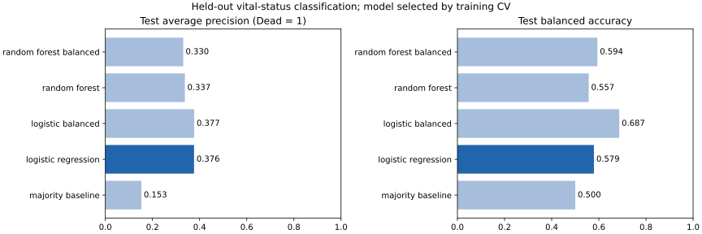
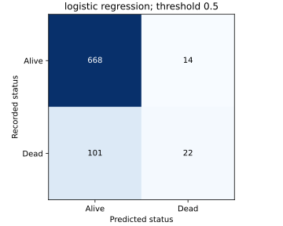

# Breast Cancer Vital Status Classification

An academic team project evaluating recorded Alive/Dead labels using Logistic Regression, Random Forest and a majority-class baseline. The workflow uses grouped holdout evaluation, fold-specific preprocessing and explicit treatment of class imbalance.

[Evaluation protocol](docs/methodology.md) · [Validation record](docs/validation.md) · [Technical review](docs/changes.md) · [CI](https://github.com/Parisa6Izadyar/Breast-Cancer/actions/workflows/tests.yml)

## Run in GitHub Codespaces

[Open in Codespaces](https://codespaces.new/Parisa6Izadyar/Breast-Cancer?ref=main)

Use the pull request branch when reviewing changes. The Python 3.12 container installs the pinned dependencies. The CSV is already included, so no Drive mount, API key or manual upload is required.

```bash
python -m pip install -r requirements.txt
python -m pytest -q
python -m breast_cancer train
```

The run prints each candidate's test average precision, ROC AUC and Dead recall, then the validation-selected model and `Finished. Results: ...`. Outputs are saved under `results/reproduced/`:

- `metrics.json`: full-precision scores, CV folds, settings, data hash and package versions.
- `model.joblib`: schema handling, fitted preprocessing and the selected classifier.
- `model_comparison.png` and `selected_confusion.png`: aggregate evaluation figures.
- `test_predictions.csv` and `split_assignments.csv`: local run records, ignored by Git.

## Data and prediction task

The bundled CSV has 4,024 rows and 16 columns. One exact duplicate is removed, leaving **4,023 records: 3,407 Alive and 616 Dead**. The four numeric and ten categorical predictors exclude `Survival Months`, which is follow-up information. See [input notes](data/README.md) and the [source inventory](data/source_inventory.json).

`Dead` is encoded as 1 and is the positive class for precision, recall, F1, average precision and ROC AUC. Everyone in this dataset already has a breast-cancer diagnosis; the target is recorded vital status. Follow-up varies, so these scores do not estimate survival at a fixed year.

Identical predictor profiles are grouped before splitting. The 3,218-row development partition uses five-fold stratified group CV; 805 rows form the held-out test. No predictor profile crosses these partitions or the inner CV folds. Missing-value imputation, scaling and category vocabularies fit each training fold. Class-weight variants handle imbalance without resampling the test distribution.

## Recorded benchmark

Model selection uses the highest mean development-CV average precision for Dead, with fixed candidate settings and a 0.5 decision threshold. Test scores do not select the model.

| Model | CV mean AP | Test AP | Test ROC AUC | Test balanced accuracy | Dead recall |
| --- | ---: | ---: | ---: | ---: | ---: |
| majority baseline | 0.1532 | 0.1528 | 0.5000 | 0.5000 | 0.0000 |
| logistic regression | 0.4114 | 0.3764 | 0.7301 | 0.5792 | 0.1789 |
| logistic balanced | 0.4072 | 0.3768 | 0.7323 | 0.6866 | 0.6341 |
| random forest | 0.3599 | 0.3374 | 0.6962 | 0.5570 | 0.1301 |
| random forest balanced | 0.3500 | 0.3304 | 0.6962 | 0.5940 | 0.3171 |

The selected model is **Logistic Regression**. Its test AP is **0.3764**, versus **0.1528** for the prior baseline, and its ROC AUC is **0.7301**. At threshold 0.5, it recalls **17.9%** of recorded Dead cases: 22 of 123, with 14 false Dead predictions among 682 Alive cases. The balanced Logistic Regression variant raises recall to **63.4%** at the cost of more false positives. The table includes both ranking and threshold-dependent metrics so that overall accuracy does not conceal this tradeoff.





[Full-precision benchmark](results/benchmark/metrics.json) includes CV variation, all class counts and confusion matrices. These results are from one retrospective split. No external validation or individual-risk calibration has been established. The earlier 96.8% accuracy came from a different, contaminated evaluation and is not used as a current performance claim.

## Notebook

`notebooks/github_breast_cancer.ipynb` contains development-data exploration, the shared model comparison and interpretation. Execute every cell with:

```bash
python scripts/execute_notebook.py
```

The script saves an executed copy in `results/notebook_check/`. CI runs the tests and every notebook cell against the bundled CSV. The source notebook is kept free of stale outputs.

## Load the saved model

After training, score a CSV containing the same predictor columns:

```bash
python -m breast_cancer predict --input data/Breast_Cancer.csv --output results/reproduced/predictions.csv
```

This demonstrates the saved pipeline's input handling on the bundled data; it is not a new held-out evaluation. The pipeline applies the same schema, imputation, scaling and one-hot encoding used in training. Prediction files contain a retrospective status score and thresholded label, not a clinical diagnosis.

## Local setup

```bash
python -m venv .venv
source .venv/bin/activate
python -m pip install -r requirements.txt
python -m pytest -q
python -m breast_cancer train
```

On Windows activate with `.venv\Scripts\activate`. CI covers Python 3.12 on Ubuntu 24.04. The CLI accepts `--input` and `--output` paths for training. Historical coursework figures and the unrelated original Excel input are preserved under `docs/legacy_figures/` and `docs/legacy_inputs/`.
